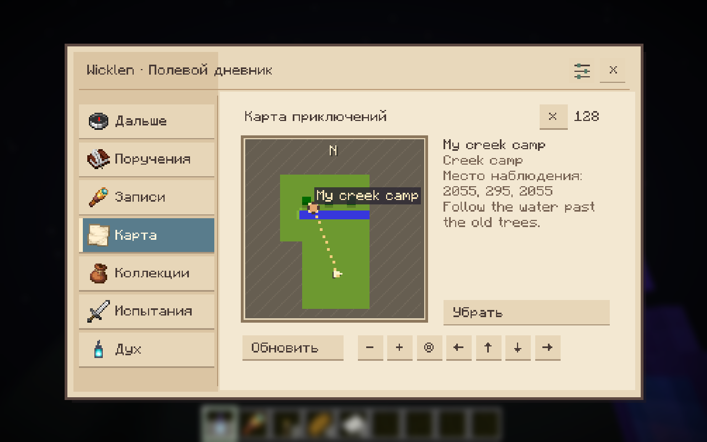
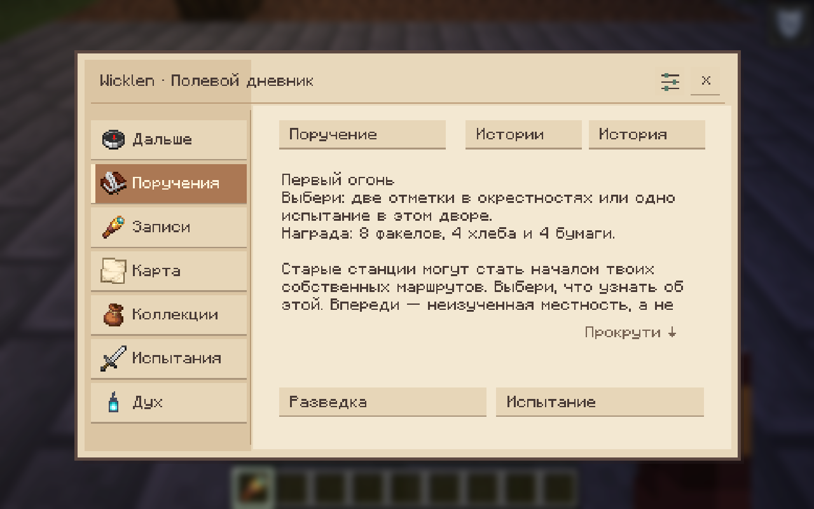
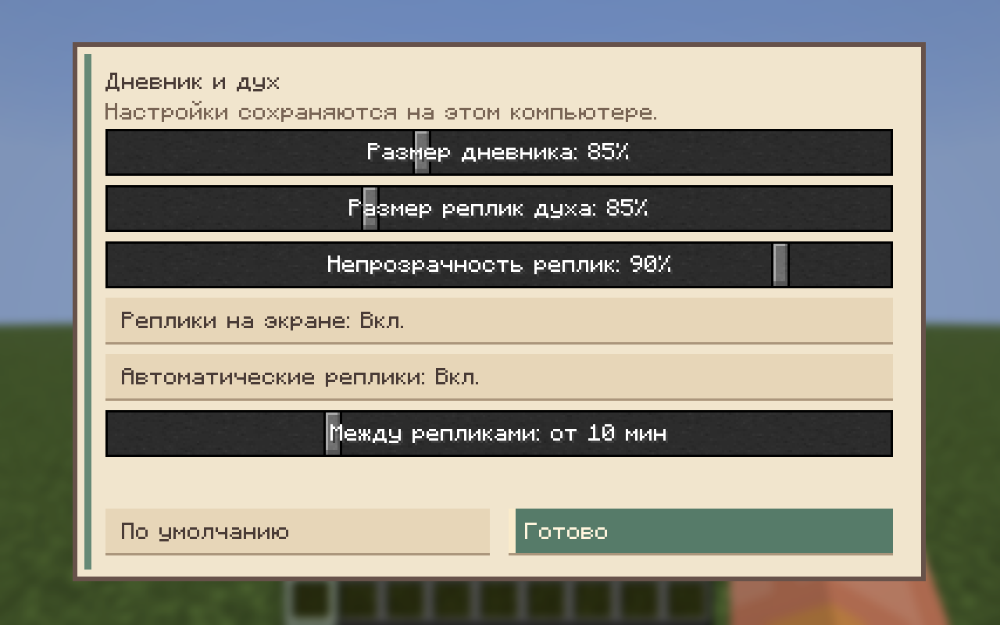
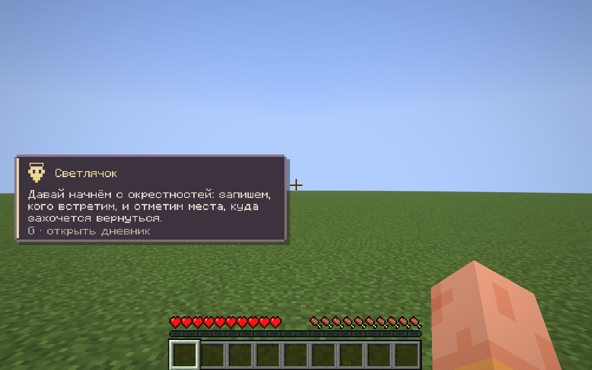

# Wicklen: Chronicles

[English](README.md) | [Русский](README.ru.md)

Part of [Wicklen-MC](https://github.com/Wicklen-MC). Server and modpack: [wicklen-server](https://github.com/Wicklen-MC/wicklen-server).

A spirit companion for the Minecraft world of **Wicklen**: conversations,
small quests and a persistent chronicle. Built for **Minecraft 26.3, Fabric
Loader 0.20.1+, Fabric API 0.165.0+26.3 and Java 25**.

## What works today

Version **0.4.3** adds the cloth wanderer spirit, movable speech cards and vanilla
help using recipes from the running server. See [release notes](docs/releases/0.4.3.md)
and the [game-help scope](docs/development/spirit-knowledge.md). Mod and modpack
versions are separate: use the exact pack selected by your server when joining it.

[Spirit design explorations](docs/design/spirit/README.md) preserve all concept
sheets and the selected cloth-wanderer direction.
The [native cloth-wanderer preview](docs/development/wanderer/README.md) includes
actual in-game screenshots and a short MP4 recording of the implemented model.

- One animated spirit per player, with four personalities and colours. It follows
  you quietly through walls, with no movement sounds or block effects.
- Spoken lines appear in a compact, themed **HUD card**, with a portrait and your
  journal key. They stay out of chat; the full text remains in journal history.
  Cards queue without interrupting each other and respect hidden HUD and menus.
- The spirit connects conversations to your saved personal names, notes, chosen
  expedition route and recent outcomes. Questions can bring older named findings
  back into context; an unfinished trip is kept distinct from a completed one.
- **G** opens a guided field journal: your next step, tasks, records, map,
  collections, trials and the spirit, all directly accessible.
  `@spirit <message>` also starts a conversation.
- Observe creatures and visible places with the **vanilla spyglass**. The server
  checks continuous focus, line of sight, range and actual item use. Registered
  structures from other mods can become places too, using visible built surfaces
  and already loaded structure pieces. A compatible
  Field Guide installation can confirm the same observation without a second scan.
- Give each personal discovery a **name and note**, without changing its canonical
  species/place, other players' records or quest objectives. Clear an edit to restore
  the original name; creature names label the species record, not individual mobs.
- A personal **terrain atlas** with real water, forest and ground, opaque unexplored
  areas, known places, a player arrow, pan/zoom and the active survey area. Nearby
  loaded surface chunks are charted as you travel; underground travel and distant
  rendering do not reveal the map. Snapshots persist on the server per player/world.
- Meaningful repeat observations: recording the same species at least 128 blocks
  from its previous recorded encounter adds field evidence, without farming first-
  discovery or collection rewards.
- **First Light**, a short Waylight expedition from a personally recorded station:
  survey its surroundings or complete its courtyard trial. Without the optional
  combat executor, the alternative is wildlife observations. One clear next step,
  visible progress, a choice of approach and an explicitly claimed supply kit.
- Follow a personally recorded place or the active expedition: a dotted map line,
  compact direction/distance card and occasional nearby **Waylight sparks** help
  you keep your bearings. Stop guidance in the journal whenever you prefer.
  A direction hint does not chart unknown terrain or promise a safe road.
- Small research collections. Unknown places never become hidden map markers.
- Collection, biome-visit and combat tasks with explicit submission and reward
  collection. Full inventories retain pending rewards.
- Story proposals with two choices, visible objectives/rewards and persistent
  consequences. An optional LLM selects from server-authored actions; unavailable
  or invalid responses use an authored fallback.
- Three waystation variants generate during decoration of **new Overworld chunks**.
  Existing chunks and player changes are not rebuilt on reload.
- Optional **Gateway of Doom** courtyard encounters, normal/empowered modes,
  explicit party consent, frozen participants and personal reward claims.
- Courtyard waves adapt gently to effective equipment and recent eligible fights.
  A bounded AI selector can choose an authored variation during preparation;
  starting never waits for it, and the accepted fight stays fixed.
- A reusable **Wayfarer's Lantern** grants brief absorption and speed, with a shared
  60-second cooldown across copies.
- A **Field Notebook** turns a cartography table into a personal field desk:
  every three new discoveries fund a kit for the next expedition.

Additional authored waystation families, longer story chains, richer observation conditions,
additional artefacts and a Xaero map overlay remain future work. The current map
is part of the journal. Combat balance still needs playtesting with the full pack.

## In-game screenshots

Native Minecraft 0.4.2 captures in a test world; these are game screens, not design mockups.

[Your next step](docs/images/journal-next.png) — The journal proposes a concrete action.

[Spyglass observation](docs/images/spyglass-observation.png) — Vanilla spyglass, target and confirmed-focus progress.

[Personal names and notes](docs/images/personal-notes.png) — Your label stays separate from the canonical species/place.



Actual sampled test terrain, personal labels and fog; this scene is a test world.



The short expedition offers explicit approaches and progress.

[Courtyard trial](docs/images/courtyard-trial.png) — The optional courtyard encounter page; Gateway is required for battles.

[Field desk](docs/images/field-desk.png) — A notebook binds an ordinary cartography table for personal resupply.



Local scale, speech visibility and automatic-remark controls.



A compact speech card; the complete text remains in journal history.

## Your first expedition

1. Bring a vanilla spyglass and hold a visible creature or supported place in view
   for about two seconds. The target name and focus progress appear above the hotbar.
2. Open **G → Records** to give the species or place a personal name and note.
   A creature entry describes a species; it does not rename that individual animal.
3. Select a known place on **Map → Follow**. Travel charts the surface around you;
   fog remains where you have not travelled. **Stop** removes the bearing.
4. At a personally recorded Wicklen waystation, open **Tasks → First Light**.
   Choose a survey or that station's available alternative. There is no time limit.
5. Return to the story page and explicitly claim your supplies. A full inventory
   lets you claim later; naming a finding or repeating a scan does not duplicate rewards.

Choose your companion's character in the journal or with `/spirit persona <id>`:

| ID | Character | Colour |
| --- | --- | --- |
| `firefly` | Shy, fond of light and stars | Warm yellow |
| `fox` | Playful, sly and teasing | Orange |
| `owl` | Thoughtful, unhurried and metaphorical | Violet |
| `cat` | Dry humour, quietly loyal | Pale blue |

These change the spirit's personality and palette, not its species or combat abilities.

## Interface and automatic remarks

Press **G → the sliders icon** in the journal's upper-right corner. Journal size
and speech-card size both default to **85%**. Adjust the journal from **65–115%**,
speech from **65–125%**, and speech opacity from **25–100%** (default 90%). You can
hide the speech card entirely; manual conversation and its history remain in the
journal. Hiding speech also pauses automatic remarks.

Automatic remarks have their own switch and a minimum interval of **2–30 minutes**,
default **10 minutes**. They need a fresh, concrete reason, so silence can last
longer. Achievement congratulations, achievement statistics and random idle talk
have been removed. Manual questions and explicitly requested task/guide feedback
keep working when automatic speech is off. Reconnecting or adjusting a slider
does not reset the last automatic remark's clock; switching off drops a pending
automatic reply before it reaches the HUD or history.

Two local sliders also place spirit speech horizontally (left → right) and vertically
(top → bottom, above the hotbar). Older settings keep the lower-left position; Reset
restores it. The settings window scales to fit small viewports.

[Native 0.4.3 settings and HUD captures](docs/releases/0.4.3.md#native-game-captures).

Presentation settings are local to `config/wicklen-chronicles-client.json`.
The server saves your automatic-speech preference and interval for this world;
visual scale, opacity and position stay on your computer.

Drag the map with the **left mouse button** and use the **wheel** to zoom around
the pointer. A short click still selects a place marker. Arrow, +/− and Center
buttons remain available: use **Tab** to focus a button and **Enter/Space** to
activate it if you prefer keyboard navigation.

## Install and play

[Download the latest release](https://github.com/Wicklen-MC/wicklen-chronicles/releases/latest) ·
[All releases](https://github.com/Wicklen-MC/wicklen-chronicles/releases) ·
[Release workflow](docs/releases/README.md)

Install Fabric Loader and Fabric API, then put
`wicklen-chronicles-0.4.3.jar` in `mods/` on both server and client. Remove
older copies of this mod first. Use matching client/server versions; the
0.2.1 networking namespace changed. The `-sources.jar` is for developers.

| Action | Command |
|---|---|
| Show / hide the companion | `/spirit summon` / `/spirit dismiss` |
| Select a personality | `/spirit persona <id>` |
| Get a quest or view its status | `/spirit quest` |
| Submit completed work | `/spirit quest turnin` |
| Collect a pending reward | `/spirit quest claim` |
| Ask for a hint on what to explore next | `/spirit guide` |
| Inspect LLM providers (operator) | `/spirit admin providers` |
| Test dialogue (operator) | `/spirit admin test <message>` |

Personality IDs: `firefly`, `fox`, `owl`, `cat`.

Command names and the `@spirit` chat trigger use English in every game language.
The message itself can be written in your preferred language.

For research, hold the spyglass on a visible target for about two seconds.
The opening **Next step** page explains your current goal and offers its main
action. Records, map, collection rewards and trials have direct navigation.
Tasks contains ordinary tasks, story choices and **First Light**; Spirit opens the
conversation. In Records, select a known creature/place and choose **Name and note**.
The terrain map charts a 3×3 area of already loaded chunks around your surface
position, independently of render distance. It starts blank until you travel;
existing discoveries can still be shown over fog. Use +/− to zoom, arrows to pan
and Center to return to your position. Only the Overworld is charted in this release.

To follow a place, open **Map**, select its personally recorded marker and press
**Follow**. Press **Stop** to remove the guidance. The dotted line shows a straight
bearing; the direction/distance card and nearby Waylight sparks help you orient
yourself. They do not find a walking path or reveal unexplored terrain. Guidance
pauses during an active trial and resumes afterwards. The current First Light
expedition can also be followed from its page.

Ask the spirit about a name you gave a finding, for example “What do you remember
about Meadow Cows? Have we finished our expedition?” It can use that name and your
note while retaining the original species, and distinguish an unfinished trip
from a completed one. These facts come from your existing saves and survive a
restart; private notes from other players are excluded. Generated conversation
still requires a configured LLM provider.

Registered structures from other mods use the same observation flow. Their
structure's origin chunk must already be loaded, and your spyglass must see a
built surface inside a registered structure piece. The observer does not load
remote chunks to find it. Ordinary decorative world-generation features or
arbitrary player buildings are not automatically supported places. Recording a
foreign dungeon does not create a Gateway arena there: authored courtyard trials
remain tied to Wicklen's own recorded stations.

After recording a waystation, open **Next step → First Light**. Survey asks for two
surface marks at least 48 blocks apart inside the highlighted 192×192-block area,
at least 32 blocks from the station; use the story's mark button or confirm an observation there. The other
route uses that station's real courtyard trial, or two new wildlife observations
when combat is unavailable. Claim **8 torches, 4 bread and 4 paper** when ready.
Look at a visible supported landmark to see its name and a spyglass hint. While
scanning, the target name and progress appear above the hotbar; a known target
is marked as already recorded. Only visible surfaces receive personal particles.

Craft a Field Notebook with one book, one paper and one string in any arrangement. Use it on a cartography
table to bind your desk, then return after three new discoveries made after binding and use it
again to receive **8 torches, 4 bread and 4 paper**. A full inventory preserves
eligibility. Sneak-use another table to relocate the desk without resetting progress.

Courtyard battles require Gateway of Doom **2.3.6 / Minecraft 26.3** on client and
server. The first profiles contain two waves and no boss; the mod owns the reward
ledger. Ordinary exploration and quests work without this optional executor.
Only personally recorded courtyards can be selected. Prepare/join explicitly,
then start with the chosen difficulty. Sparks show the boundary; stepping outside
gives you five seconds to return. Escaping encounter mobs are safely returned
instead of cancelling the battle. Death, disconnecting or staying outside for
the full grace period aborts it. Pending earned rewards survive a restart.

Developer commands for parties: `/spirit encounter`, `/spirit encounter prepare
normal`, `/spirit encounter prepare empowered`, `/spirit encounter join <id>`,
`/spirit encounter start <id>`, `/spirit encounter leave <id>` and
`/spirit encounter claim <rewardId>`.

Quest readiness never takes items automatically. Collection quests recheck
what is actually in the inventory when submitted. Rewards are fixed when
issued and survive a normal world restart. Inventory and mod data are
separate save resources, not a shared transaction during abrupt power loss.

## Rewards that support the next trip

| Activity | Reward | Repeat rule |
| --- | --- | --- |
| Record three creature species | 8 paper | Once per player/world; claim in Collections |
| Record two places | 12 torches | Once per player/world; claim in Collections |
| Complete First Light | 8 torches, 4 bread, 4 paper | One story per player/world; explicit claim |
| Return to a bound field desk after three new discoveries | 8 torches, 4 bread, 4 paper | Each next group of three first discoveries |
| Win a personally joined courtyard trial | Wayfarer's Lantern | Personal encounter reward; explicit claim |

The lantern is earned rather than crafted. Use it to gain **Absorption I for
20 seconds** and **Speed I for 10 seconds**. It is reusable; all copies share a
**60-second cooldown**. Re-observing a known species in another region adds field
knowledge, rather than another first discovery or another collection entitlement.

## Gentle encounters and diagnostics

The least equipped participant sets the equipment tier. Recent failures can
reduce enemy count and damage; victories do not automatically escalate difficulty.
Two waves contain at most eight enemies each. Normal newcomers meet weaker
melee enemies; better equipment unlocks a small ranged component. Empowered
is a modest optional increase. Creative and Adventure remain allowed; debug
fights do not affect future difficulty. These are initial authored limits,
not a guarantee of balance with every third-party modifier.

During preparation, the configured LLM can select `steady`, `melee` or `breather`
from server-built plans. It receives anonymous equipment capabilities and recent
outcomes. `encounterAiPlanning: false` disables this selection; immediate
equipment-based planning remains available. Shared AI request budgets apply.
Equipment or party changes invalidate the cached selection. The final plan is
saved before Gateway opens; late responses never alter an active battle.

`<world>/wicklen-chronicles/combat-events.jsonl` records preparation, start, waves,
completion/cancellation reason and reward claims. It rotates at 1 MiB with one
previous copy. `combat-history.json` keeps at most 64 summaries; only the latest
eight eligible party results influence relief. Diagnostics omit chat and full
inventories; a logging failure does not block gameplay or rewards.

## Configuration and saves

`config/wicklen-chronicles.json` is created on first launch. It controls the
provider, request limits, token budget, temperature and proactive messages.
Set `proactive: false` to disable automatic LLM remarks while retaining
manual conversations and deterministic quests. `firstLightAiNarration: false`
disables the optional opening prose for First Light. Its authored version remains
complete; AI never defines its objectives, creates structures or changes rewards.
Server-wide `aiParallelRequests`,
`aiQueueCapacity`, `aiRequestsPerHour` and `aiOutputTokensPerHour` bound shared
HTTP concurrency, waiting requests, request count and reserved maximum output tokens.
Queued requests expire, and late responses from closed worlds are rejected.

Generated conversation sends the configured provider your in-game name, question,
recent dialogue and a limited context such as biome, health, visible threats,
selected personal names/notes and saved expedition progress. Relevant server rumours
or pet memories can also be included. Personal annotation retrieval excludes other
players' notes. The journey-memory projection omits world seed, UUIDs and global
coordinates; text you choose to put in a message or note is still your text.
Use a local Ollama endpoint if you want locally hosted generation. Maps, observations,
objectives and reward checks work without an LLM. AI does not operate the world or
invent authoritative discoveries; unavailable/invalid story and battle selections
fall back to authored choices. Server-wide budgets are shared by all players.

Use environment variables for credentials; do not commit keys or personal
configuration. `SPIRIT_PROVIDER` selects `deepseek`, `openai`, `ollama` or
`custom`. Corresponding variables include `DEEPSEEK_API_KEY`, `OPENAI_API_KEY`,
`OLLAMA_BASE_URL` / `OLLAMA_MODEL`, and `CUSTOM_BASE_URL` / `CUSTOM_MODEL` /
`CUSTOM_API_KEY`. A config value `env:VARIABLE_NAME` reads an environment variable.

Progress is stored in `<world>/wicklen-chronicles/`. JSON saves have a schema
version; unknown or corrupt formats are preserved rather than reset. Personal
annotations, field evidence and First Light have separate ledgers. Terrain uses
checked, bounded binary region snapshots under `terrain-map/`; it is a map of past
surface visits, not live satellite imagery. Names do not advance discovery revisions.
Existing station records can offer First Light after upgrading; no world reset is needed.

### Compatibility with earlier releases

Only the compatibility adapter and the mod dependency alias retain the old
`redzspirit` namespace. Old saved `redzspirit:spirit` entities still load;
new entities, packets, resources and keybindings use `wicklen_chronicles`.

When the current destination is absent, the adapter validates and moves
`<world>/redzspirit/` to `<world>/wicklen-chronicles/`, and
`config/redzspirit.json` to `config/wicklen-chronicles.json`. World IDs and
file contents are preserved. If both paths exist, current data wins and
old data remains untouched; unsupported schemas block migration.

The old global game-directory save cannot be assigned to a world safely.
It is left untouched for manual migration after selecting the intended
world and backing up both sources. Stop the server before moving files.
The old per-world `quests.json` converts to `quest-ledger.json` when the
latter is absent; the original quest file remains available.

## Build and tests

Set `JAVA_HOME` to a **JDK 25** installation. The Gradle wrapper is included;
no personal cache path, local server configuration or external LLM key is needed.

```sh
./gradlew build
# build/libs/wicklen-chronicles-0.4.3.jar
./gradlew -p core check
./gradlew runServerSmoke
./gradlew runClientGameTest
./gradlew runServerSmoke -PverifyStationsSmokes=true
```

`build` runs core rules, storage/migration, quest-adapter and localhost mock
HTTP checks. `-p core check` configures only plain Java, without Minecraft/Loom.
`runServerSmoke` boots an isolated dedicated server on a loopback ephemeral
port, verifies registration/storage and stops automatically. It requires an
existing developer EULA acceptance in `run/eula.txt`; it does not accept one
for you. `runClientGameTest` requires a graphical session and verifies the
conversation UI, networking, quest hand-in/rewards and world reopen.
Test worlds, logs and screenshots stay under `build/`.

The station flag uses an isolated flat fixture with increased station frequency,
checks all variants and leaves a marker to verify persistence on a second run.
It does not change the normal world generator. Optional combat checks additionally
require verified Gateway/SIH JARs and the managed profile in `build/combat-smoke/`;
run with both `-PverifyStationsSmokes=true -PverifyCombatSmokes=true`.
External LLM credentials are unnecessary for the localhost mock-provider tests.

External-provider verification is opt-in and reads an existing private config:

```sh
./gradlew liveStoryProviderTest -PliveSpiritConfig=/absolute/private/config.json
./gradlew liveEncounterProviderTest -PliveSpiritConfig=/absolute/private/config.json
./gradlew liveJourneyMemoryTest -PliveSpiritConfig=/absolute/private/config.json
```

It makes a real request, never prints credentials and does not change the config.
It is deliberately excluded from `build` / `check`.

## Architecture

`core` contains immutable discovery, quest, story, research and encounter state and rules,
with no Minecraft, Fabric, JSON or HTTP dependencies. `fabric` translates
verified game events into core inputs and owns inventory, registries,
world storage, network messages, LLM calls and client presentation. One
installable JAR bundles both; test code is excluded.

Java namespace: `dev.wicklen.chronicles`. Maven coordinates:
`dev.wicklen:wicklen-chronicles`. Project code is MIT-licensed.
