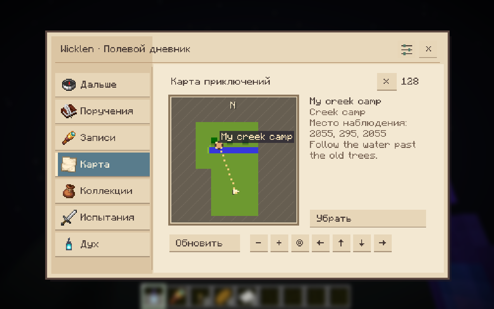
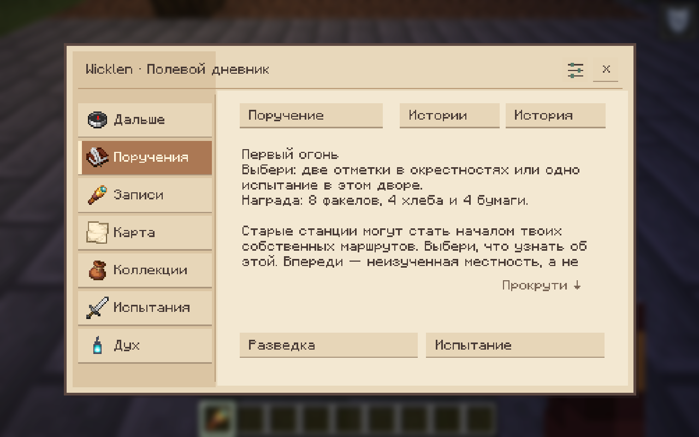
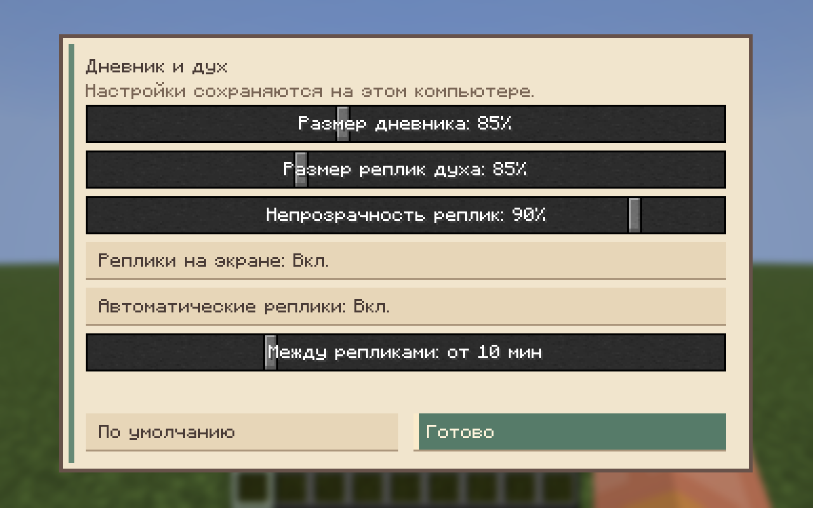
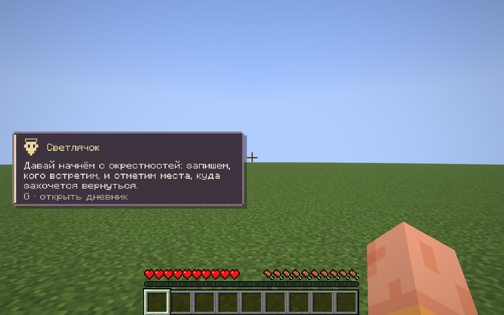

# Wicklen: Chronicles

В разработке **0.4.3-SNAPSHOT**: доработка модели духа и небольшой слой ванильной
справки с рецептами текущего сервера. [Описание и границы](docs/development/spirit-knowledge.md).
Опубликованный мод **0.4.2** и действующая сборка **0.4.3** — отдельные версии.

[Варианты внешности духа](docs/design/spirit/README.ru.md): все наброски и выбранное
направление странника в тканевом капюшоне.

[English](README.md) | [Русский](README.ru.md)

Проект организации [Wicklen-MC](https://github.com/Wicklen-MC). Сервер и сборка: [wicklen-server](https://github.com/Wicklen-MC/wicklen-server).

Дух-компаньон для мира **Wicklen (Виклен)**: диалоги, небольшие задания и
сохраняемая летопись. **Minecraft 26.3, Fabric Loader 0.20.1+,
Fabric API 0.165.0+26.3 и Java 25**.

## Что уже работает

Реплики духа теперь появляются в небольшой **экранной карточке** с портретом
и клавишей дневника. Полный текст остаётся в истории; дублирования в чат нет.
Карточки не перебивают друг друга, учитывают меню и скрытие HUD.


- Один анимированный дух на игрока, четыре характера и цвета. Он сопровождает
  игрока и проходит сквозь стены без звуков движения и эффектов блоков.
- Дух использует сохранённые личные имена, заметки, выбранный путь и результаты
  походов в разговоре. По вопросу вспоминает старые названные находки и различает
  начатую вылазку, успешное завершение и неудачу.
- **G** открывает дневник с ближайшим шагом и прямым доступом к поручениям,
  записям, карте, коллекциям, испытаниям и разговору с духом.
  Обращение в чате — `@spirit <сообщение>`.
- Наблюдения существ и видимых мест через **ванильную подзорную трубу**.
  Сервер проверяет фокусировку, видимость, дальность и использование предмета.
  Зарегистрированные структуры других модов тоже распознаются по видимой части
  постройки и уже загруженным данным. Совместимый Field Guide позволяет засчитать то же наблюдение без второго скана.
- **Личные подписи и заметки** к открытиям. Исходный тип, задания и чужие записи
  сохраняются; очистка возвращает исходное имя. Подпись существа относится к записи
  вида, а не переименовывает отдельных мобов в мире.
- **Карта настоящей местности**: вода, лес и земля, туман неизвестного, известные
  места, положение игрока, масштаб, перемещение и активная область разведки.
  Ближайшие загруженные участки открываются при путешествии по поверхности;
  подземные перемещения и дальняя отрисовка карту не раскрывают. Снимки личные,
  сохраняются на сервере и переживают смену компьютера.
- Повторное наблюдение знакомого вида минимум в 128 блоках от прошлой встречи
  добавляет полевые сведения, сохраняя однократность наград за первое открытие.
- **«Первый огонь»** — короткая история от лично записанной станции Путевых огней:
  разведать окрестности или пройти её двор. Без боевого исполнителя второй путь —
  новые наблюдения существ. Понятный следующий шаг, прогресс и явное получение припасов.
- Можно следовать записанному месту или текущей экспедиции: пунктир на карте,
  компактное направление с расстоянием и редкие **путевые искры** вблизи игрока.
  Ориентир отключается в дневнике. Подсказка направления сохраняет туман карты
  и не обещает готовую безопасную дорогу.
- Небольшие исследовательские серии. Неизвестные места не передаются клиенту
  как скрытые маркеры.
- Задания на сбор, посещение биомов и бой, явная сдача и получение награды.
  При полном инвентаре награда остаётся ждать.
- Истории с двумя вариантами, видимыми целями/наградами и сохранением выбора.
  Необязательная LLM выбирает доступные серверные действия; при ошибке или
  недоступности модели используется подготовленный эпизод.
- Три варианта станций появляются при генерации **новых чанков верхнего мира**.
  Уже созданные чанки и изменения игроков не перестраиваются при загрузке.
- Необязательные испытания двора через **Gateway of Doom**: обычный и усиленный
  варианты, явное участие, фиксированный состав и личные награды.
- Мягкая настройка волн по экипировке и недавним боям. ИИ может выбрать
  подготовленный вариант до старта; активный бой остаётся фиксированным.
- **Фонарь странника** даёт кратковременные поглощение и скорость. У всех копий
  общий таймер восстановления — 60 секунд.
- **Полевой блокнот** превращает стол картографа в личный полевой стол:
  каждые три новых открытия позволяют получить припасы для следующего похода.

Новые авторские семейства станций, длинные сюжетные серии, более сложные условия наблюдений,
другие артефакты и слой поверх карты Xaero остаются дальнейшей работой.
Текущая карта находится в дневнике. Баланс боя требует плейтеста полным модпаком.

## Настоящие игровые экраны

Снимки настоящего Minecraft 0.4.2 в тестовом мире; это игровые экраны, а не макеты.

[Следующий шаг](docs/images/journal-next.png) — Дневник предлагает конкретное следующее действие.

[Наблюдение трубой](docs/images/spyglass-observation.png) — Ванильная труба, название цели и прогресс фокусировки.

[Личные подписи и заметки](docs/images/personal-notes.png) — Личная подпись сохраняет исходный вид существа или тип места.



Настоящий рельеф тестового мира, личные подписи и туман; это тестовая сцена.



Короткая вылазка с явным выбором пути и прогрессом.

[Испытание двора](docs/images/courtyard-trial.png) — Страница необязательного испытания двора; для боя нужен Gateway.

[Полевой стол](docs/images/field-desk.png) — Блокнот привязывает обычный стол картографа для личного снабжения.



Размер интерфейса, видимость карточки и настройки автоматических реплик.



Компактная карточка; полный текст остаётся в истории дневника.

## Первая вылазка

1. Возьмите обычную подзорную трубу и около двух секунд удерживайте в поле зрения
   существо или поддерживаемое место. Над хотбаром появятся цель и прогресс.
2. Откройте **G → Записи**, дайте находке своё имя и заметку. Для существа это
   запись вида: отдельная корова в мире от этого не переименуется.
3. На **Карте** выберите записанное место и нажмите **«Путь»**. Поверхность
   открывается по мере путешествия; **«Убрать»** отключает направление.
4. Записав станцию Wicklen, откройте **Поручения → Первый огонь**. Выберите
   разведку или доступный второй путь. Ограничения по времени нет.
5. Выполните цель и явно заберите припасы на странице истории. При полном
   инвентаре они подождут. Подписи и повторные сканы не дублируют награды.

Характер выбирается в дневнике или командой `/spirit persona <id>`:

| ID | Характер | Цвет |
| --- | --- | --- |
| `firefly` | Робкий, любит свет и звёзды | Тёплый жёлтый |
| `fox` | Хитрый, игривый, любит поддразнить | Оранжевый |
| `owl` | Вдумчивый, неспешный, говорит образно | Фиолетовый |
| `cat` | Сухой юмор и скрытая преданность | Светло-голубой |

Это характер и палитра духа, а не отдельные виды существ или боевые классы.

## Полевой атлас 0.4.2

В записях выберите известное место или вид и нажмите «Имя и заметка».
Карта открывает область 3×3 уже загруженных чанка вокруг игрока на поверхности,
независимо от дальности отрисовки. Старый мир начнёт заполняться при путешествии;
известные места могут стоять поверх тумана. +/− меняют масштаб, стрелки перемещают
карту, центрирование возвращает к игроку. Пока картографируется только Верхний мир.

Чтобы дойти до находки, откройте **Карту**, выберите **маркер лично записанного
места** и нажмите **«Путь»**. **«Убрать»** отключает ориентир. Пунктир показывает
прямое направление; карточка с направлением и расстоянием и близкие искры
Путевых огней помогают сориентироваться. Это не построенный маршрут обхода
препятствий и не раскрытие тумана. Во время испытания ориентир временно скрывается,
затем возвращается. Текущую цель «Первого огня» можно выбрать на странице истории.

Спросите духа, например: «Что ты помнишь о Луговых коровах? Наш поход уже закончен?»
Он может вспомнить ваше название и заметку, сохраняя исходный вид существа,
и отличить выбранную цель от действительно завершённой вылазки. Эти сведения
читаются из существующих сохранений и доступны после перезапуска; чужие личные
заметки не передаются. Для генерируемых ответов нужен настроенный LLM-провайдер.

Постройки других модов наблюдаются тем же способом, если они зарегистрированы
как структуры: исходный чанк уже загружен, а труба видит построенную поверхность
внутри одной из частей структуры. Ради распознавания дальние чанки не загружаются.
Обычные декоративные features генерации и произвольные дома игроков автоматически
местами не становятся. Запись чужого данжа не создаёт там арену Gateway:
испытания по-прежнему связаны с собственными записанными станциями Wicklen.

После наблюдения станции откройте «Следующий шаг → Первый огонь». Разведка требует
двух отметок на поверхности в выделенной области 192×192 блока, минимум в 48 блоках
друг от друга и в 32 блоках от станции. Используйте кнопку отметки в истории или подтвердите
наблюдение в нужном месте. Другой путь — реальное испытание на этой станции либо
два новых полевых наблюдения, если боевой исполнитель недоступен. По завершении
заберите **8 факелов, 4 хлеба и 4 бумаги**. Старая известная станция тоже подходит.

LLM может написать вступление по факту найденной станции; при недоступности модели
работает подготовленный текст. `firstLightAiNarration: false` отключает эту генерацию.
Цели, область и награды определяет сервер. Подписи не меняют ревизию открытий и не
сбрасывают предложенную историю. Обновление не требует пересоздания мира.

## Размер интерфейса и автоматические реплики

Нажмите **G → значок ползунков** справа вверху дневника. Размер дневника и карточки
реплик по умолчанию — **85%**. Дневник регулируется в пределах **65–115%**,
реплики — **65–125%**, непрозрачность — **25–100%** (по умолчанию 90%). Карточку
можно полностью скрыть; ручной разговор и история остаются в дневнике. Скрытие
карточки также приостанавливает автоматические реплики.

У автоматических реплик есть отдельный выключатель и минимальный интервал
**2–30 минут**, по умолчанию **10 минут**. Нужен свежий конкретный повод, поэтому
дух может молчать дольше. Поздравления за ачивки, их статистика и случайная болтовня
убраны. Ручные вопросы и явно запрошенные ответы о поручениях или маршруте работают
при выключенном AUTO. Повторный вход и изменение ползунка не сбрасывают время
предыдущей автореплики; отключение отбрасывает и уже ожидающий автоматический ответ.

Вид интерфейса сохраняется локально в `config/wicklen-chronicles-client.json`.
Сервер хранит личные настройки автоматической речи и её интервал для этого мира;
размер и непрозрачность остаются на вашем компьютере.

Карту можно **перетаскивать левой кнопкой мыши** и **масштабировать колесом вокруг
указателя**. Короткий клик по-прежнему выбирает маркер места. Кнопки стрелок, +/−
и центрирования сохранены; для управления клавиатурой выбирайте их через **Tab**
и нажимайте **Enter/пробел**.

## Установка и игра

[Скачать последний релиз](https://github.com/Wicklen-MC/wicklen-chronicles/releases/latest) ·
[Все релизы](https://github.com/Wicklen-MC/wicklen-chronicles/releases) ·
[Выпуск через workflow](docs/releases/README.md)

Установите Fabric Loader и Fabric API, затем положите
`wicklen-chronicles-0.4.2.jar` в `mods/` сервера и клиента. Сначала удалите
старые копии этого мода. Версии на клиенте и сервере должны совпадать:
в 0.2.1 изменился сетевой namespace. `-sources.jar` нужен разработчикам.

| Действие | Команда |
|---|---|
| Призвать / скрыть духа | `/spirit summon` / `/spirit dismiss` |
| Выбрать характер | `/spirit persona <id>` |
| Получить задание или посмотреть текущее | `/spirit quest` |
| Сдать выполненное | `/spirit quest turnin` |
| Получить ожидающую награду | `/spirit quest claim` |
| Попросить совет, куда двигаться дальше | `/spirit guide` |
| Посмотреть LLM-провайдеров (оператор) | `/spirit admin providers` |
| Проверить диалог (оператор) | `/spirit admin test <сообщение>` |

ID характеров: `firefly`, `fox`, `owl`, `cat`.

Имена команд и обращение `@spirit` всегда на английском, независимо от языка
игры. Само сообщение можно писать на удобном вам языке.

Для наблюдения удерживайте подзорную трубу на видимой цели около двух секунд.
Стартовый раздел **Дальше** объясняет текущую цель и предлагает основное
действие. Записи, карта, коллекции и испытания доступны напрямую. В поручениях
находятся задания и сюжетные варианты, в разделе духа — разговор.
Если посмотреть на видимое распознаваемое место, появятся название и совет
рассмотреть его в трубу. Во время наблюдения над панелью предметов видны
цель и прогресс; уже записанная цель отмечается отдельно. Личные частицы
подсвечивают только реально видимую поверхность.

Полевой блокнот создаётся из одной книги, одной бумаги и одной нити без заданного расположения. Используйте его на столе
картографа, затем вернитесь после трёх новых открытий, сделанных после привязки, и используйте снова:
набор содержит **8 факелов, 4 хлеба и 4 бумаги**. Полный инвентарь сохраняет
право на набор. Использование с приседанием на другом столе переносит базу,
сохраняя прогресс.

Для испытаний нужен Gateway of Doom **2.3.6 / Minecraft 26.3** на клиенте и
сервере. Первые профили содержат две волны без босса; награды учитывает наш мод.
Исследование и обычные задания работают без этой интеграции. Выбирать можно
только лично записанные дворы. Подготовка/вступление явные, затем участники
запускают выбранный вариант. Искры отмечают границу: при случайном выходе
есть пять секунд вернуться. Выбежавшие противники безопасно возвращаются
во двор, бой продолжается. Смерть, отключение или отсутствие за границей
дольше пяти секунд отменяют встречу. Уже заработанная ожидающая награда
сохраняется между перезапусками.

Команды для проверки и сбора группы: `/spirit encounter`, `/spirit encounter
prepare normal`, `/spirit encounter prepare empowered`, `/spirit encounter
join <id>`, `/spirit encounter start <id>`, `/spirit encounter leave <id>`,
`/spirit encounter claim <rewardId>`.

Готовность сама не забирает предметы. При сдаче сбора проверяется реальный
инвентарь. Награда фиксируется при выдаче задания и сохраняется между обычными
перезапусками мира. Инвентарь и данные мода сохраняются раздельно:
при аварийном выключении это не единая транзакция.

## Награды для следующего похода

| Действие | Награда | Повторение |
| --- | --- | --- |
| Записать три вида существ | 8 бумаги | Один раз на игрока/мир; забрать в коллекциях |
| Записать два места | 12 факелов | Один раз на игрока/мир; забрать в коллекциях |
| Пройти «Первый огонь» | 8 факелов, 4 хлеба, 4 бумаги | Одна история на игрока/мир; явное получение |
| Вернуться к полевому столу после трёх новых открытий | 8 факелов, 4 хлеба, 4 бумаги | Каждая следующая тройка первых открытий |
| Победить в испытании, в котором лично участвовали | Фонарь странника | Личная награда встречи; явное получение |

Фонарь получают за бой, рецепта у него нет. Использование даёт **Поглощение I
на 20 секунд** и **Скорость I на 10 секунд**. Предмет многоразовый; у всех копий
общая **перезарядка 60 секунд**. Повторное наблюдение вида в другой области —
новое полевое знание, а не ещё одно первое открытие или повторная награда серии.

## Мягкая настройка боя и диагностика

Предел сложности задаёт экипировка самого слабого участника. Недавние неудачи
могут уменьшить число врагов и урон; победы автоматически не усиливают бой.
В каждой из двух волн не больше восьми противников. Новичок без брони встречает
ослабленных бойцов ближнего боя, подготовленная группа — немного стрелков.
Усиленный вариант добавляет умеренную сложность. Креатив и приключение разрешены;
тестовые бои не влияют на адаптацию. Баланс со сторонними модификаторами требует плейтеста.

Во время подготовки настроенная LLM выбирает серверный вариант `steady`,
`melee` или `breather` по обезличенным параметрам экипировки и исходам боёв.
`encounterAiPlanning: false` отключает этот выбор; мгновенный план по экипировке
остаётся. Действуют общие бюджеты ИИ. Изменение состава или экипировки отменяет
закэшированный выбор. План сохраняется до открытия Gateway; запоздавший ответ
не меняет активный бой.

В `<мир>/wicklen-chronicles/combat-events.jsonl` пишутся подготовка, старт, волны,
завершение/отмена с причиной и получение награды. Журнал ограничен 1 МиБ с одной
предыдущей копией. `combat-history.json` хранит до 64 сводок; для облегчения
используются восемь последних подходящих результатов группы. Разговоры и полный
инвентарь не записываются. Сбой диагностики не блокирует игру.

## Настройки и сохранения

При первом запуске создаётся `config/wicklen-chronicles.json`: провайдер,
лимиты запросов, бюджет токенов, температура и автоматические реплики.
`proactive: false` отключает автоматические LLM-реплики, сохраняя ручные
диалоги и детерминированную работу заданий. Общие серверные лимиты
`aiParallelRequests`, `aiQueueCapacity`, `aiRequestsPerHour`,
`aiOutputTokensPerHour` ограничивают параллельные запросы, очередь, количество
запросов и резерв максимальных выходных токенов. Ожидание в очереди ограничено,
ответы из закрытой игровой сессии отклоняются.

Для генерируемого разговора настроенному провайдеру передаются игровое имя,
вопрос, недавний диалог и ограниченный контекст: например, биом, здоровье,
видимые угрозы, выбранные личные подписи/заметки и сохранённый прогресс вылазки.
В контекст также могут попасть серверные слухи или память о питомцах. Личные
заметки других игроков в подборку записей не входят. Проекция памяти похода
не включает seed, UUID и глобальные координаты; написанный вами текст вопроса
или заметки при этом остаётся вашим текстом. Для локальной генерации можно
настроить Ollama. Карта, наблюдения, цели и проверка наград работают без LLM.
ИИ не управляет миром и не создаёт подтверждённые находки; при недоступности
или невалидном выборе истории/боя используются авторские варианты. Серверные
бюджеты запросов общие для всех игроков.

Ключи храните в переменных окружения; не коммитьте секреты и личные конфиги.
`SPIRIT_PROVIDER` выбирает `deepseek`, `openai`, `ollama` или `custom`.
Используются `DEEPSEEK_API_KEY`, `OPENAI_API_KEY`, `OLLAMA_BASE_URL` /
`OLLAMA_MODEL`, `CUSTOM_BASE_URL` / `CUSTOM_MODEL` / `CUSTOM_API_KEY`.
Значение конфига `env:VARIABLE_NAME` читает переменную окружения.

Прогресс находится в `<мир>/wicklen-chronicles/`. У JSON есть версия схемы;
повреждённые и неизвестные форматы сохраняются для восстановления.

### Совместимость с прошлыми версиями

Старый namespace `redzspirit` остаётся только в адаптере совместимости и
алиасе зависимости мода. Сохранённые сущности `redzspirit:spirit` загружаются;
новые сущности, пакеты, ресурсы и клавиши используют `wicklen_chronicles`.

Если нового пути нет, адаптер проверяет и перемещает
`<мир>/redzspirit/` в `<мир>/wicklen-chronicles/`, а
`config/redzspirit.json` — в `config/wicklen-chronicles.json`. ID мира и
содержимое файлов сохраняются. Если существуют оба пути, используется
новый, старый остаётся без изменений. Неизвестная схема останавливает перенос.

Старые общие данные папки запуска нельзя автоматически приписать миру:
они остаются для ручного переноса после выбора нужного мира и резервного
копирования обоих источников. Переносить файлы нужно при остановленном сервере.
Старый `quests.json` внутри выбранного мира преобразуется в `quest-ledger.json`,
если нового файла ещё нет; исходник заданий сохраняется.

## Сборка и проверки

Укажите **JDK 25** в `JAVA_HOME`. Gradle wrapper включён в проект.
Личные пути к cache, серверные конфиги и внешние LLM-ключи не требуются.

```sh
./gradlew build
# build/libs/wicklen-chronicles-0.4.2.jar
./gradlew -p core check
./gradlew runServerSmoke
./gradlew runClientGameTest
./gradlew runServerSmoke -PverifyStationsSmokes=true
```

`build` проверяет ядро, хранилища/миграции, адаптер заданий и HTTP через mock
на localhost. `-p core check` конфигурирует только Java без Minecraft/Loom.
`runServerSmoke` запускает отдельный dedicated server на случайном порту
loopback, проверяет регистрацию/данные и автоматически останавливается.
Требуется ранее принятое разработчиком EULA в `run/eula.txt` — тест не принимает
его за вас. `runClientGameTest` требует графическую сессию и проверяет диалог,
сеть, сдачу/награды и повторное открытие мира. Миры, логи и скриншоты тестов
находятся в `build/`.

Флаг станций использует отдельный плоский тестовый мир с повышенной частотой
мест, проверяет три варианта и сохраняет маркер для повторного запуска. Обычный
генератор мира не меняется. Для необязательной боевой проверки нужны проверенные
Gateway/SIH JAR и управляемый профиль в `build/combat-smoke/`; запуск — с двумя
флагами `-PverifyStationsSmokes=true -PverifyCombatSmokes=true`. Внешние ключи
LLM не нужны для тестов с локальным mock-провайдером.

Проверка внешнего провайдера запускается отдельно с приватным конфигом:

```sh
./gradlew liveStoryProviderTest -PliveSpiritConfig=/absolute/private/config.json
./gradlew liveEncounterProviderTest -PliveSpiritConfig=/absolute/private/config.json
./gradlew liveJourneyMemoryTest -PliveSpiritConfig=/absolute/private/config.json
```

Она выполняет реальный запрос, не выводит ключ и не меняет конфиг.
В обычные `build` / `check` эта проверка не входит.

## Архитектура

`core` содержит неизменяемые открытия, задания, истории, исследования, встречи и правила без
Minecraft, Fabric, JSON и HTTP. `fabric` переводит проверенные события игры
во входы ядра и отвечает за инвентарь, реестры, сохранения, сеть, LLM и интерфейс.
Оба слоя входят в один устанавливаемый JAR; тестовый код в него не включается.

Java namespace: `dev.wicklen.chronicles`. Maven coordinates:
`dev.wicklen:wicklen-chronicles`. Код проекта — под лицензией MIT.
