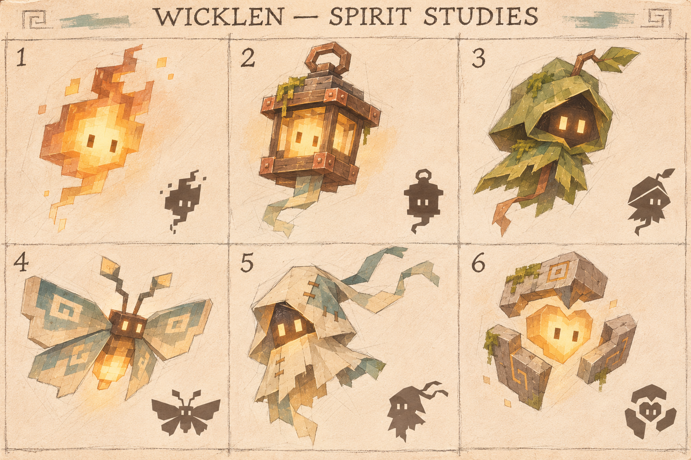
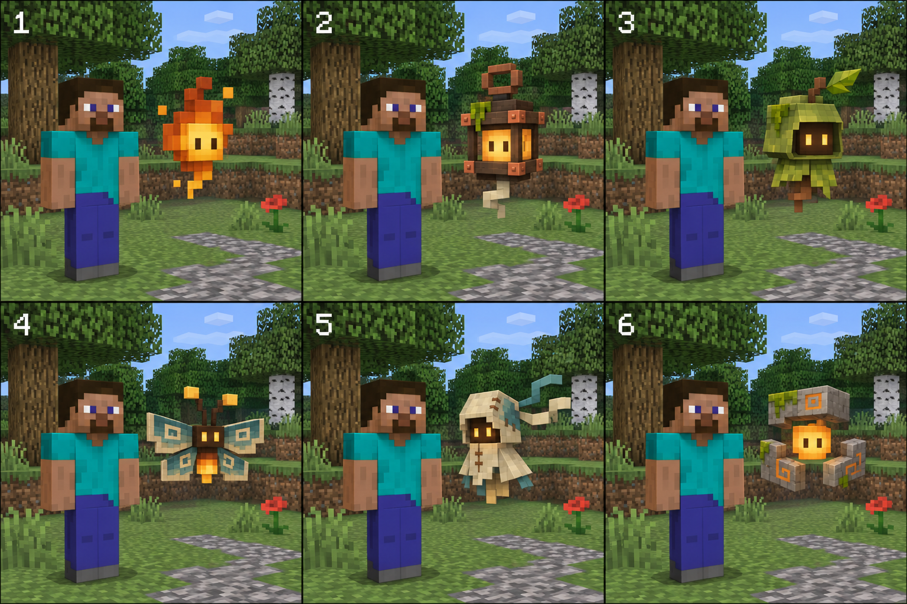
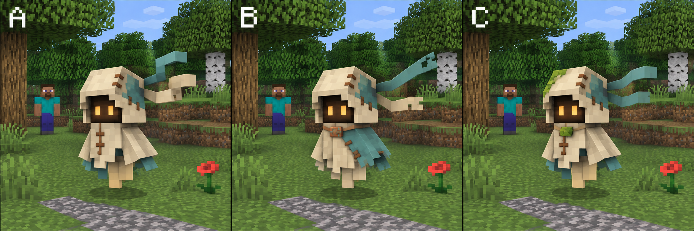

# Spirit design exploration

[English](README.md) | [Русский](README.ru.md)

Generated concept sheets from **7 November 2026**. These images explore a future
companion design; they are **not Minecraft screenshots or implemented models**.
Minecraft-style sheets approximate block geometry and pixel textures, but final
size, materials, lighting and animation must be checked with a native model.

## Current direction

The maintainer prefers **5 — cloth wanderer**, and also likes **3 — woodland hood**.
Keep the wanderer's small off-white hood, recessed dark face, warm eyes, teal
patches and trailing cloth as the main identity. Subtle woodland details are an
optional variation, not a decision to replace the cloth with leaves. No A/B/C
refinement from the third sheet has been chosen yet.

| Sheet | Contents |
| --- | --- |
| [01 — rough studies](01-rough-studies.png) | Six early illustrated directions, with silhouette thumbnails |
| [02 — Minecraft-style options](02-minecraft-style-options.png) | The same six directions with block forms, pixel textures and a player scale reference |
| [03 — wanderer variations](03-wanderer-variations.png) | A: closest to option 5; B: asymmetrical traveller with a clasp; C: restrained moss/leaf detail |

Numbering in the first two sheets: **1** ember, **2** living lantern, **3** woodland
hood, **4** moth, **5** cloth wanderer, **6** relic fragments.

## Provenance

Generated with the built-in **image_gen** tool. All three original PNGs are saved
unchanged in this directory. [Prompts](prompts.md) preserve the generation briefs;
[manifest.json](manifest.json) records image dimensions, SHA-256 hashes, reference
relationships and the selection state. Files contain no credentials or personal
machine paths.

The earlier [native development prototype](../../development/spirit-knowledge.md)
is documented separately. Its real captures do not depict the newly selected
cloth-wanderer concept. Saving these sheets does not implement or release it.
