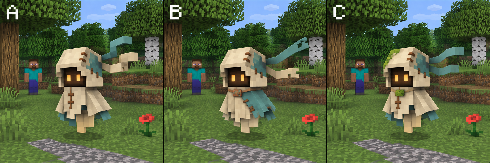

# Поиск образа духа

[English](README.md) | [Русский](README.ru.md)

Здесь сохранены все три листа от **7 ноября 2026**. Это **сгенерированные концепты**;
сцены в стиле Minecraft помогают оценить форму и масштаб. Реальные геометрию,
освещение и анимацию предстоит проверить на игровой модели.

## Выбранное направление

Больше всего понравился **№ 5 — странник в тканевом капюшоне**; также понравился
**№ 3 — лесной дух**. Основой остаются светлая ткань, тёмное лицо, тёплые глаза,
бирюзовые заплаты и развевающиеся ленты. Лесные детали можно попробовать как
небольшой акцент. После команды «давай делать» за основу реализации взят **A** —
самый близкий к понравившемуся № 5. Отдельного выбора между A/B/C не было.
[Настоящая модель, скриншоты и видео из Minecraft](../../development/wanderer/README.md).

1. [Первые наброски](01-rough-studies.png): огонёк, фонарь, лесной капюшон,
   мотылёк, тканевый странник и древний осколок.
2. [Сравнение в стиле Minecraft](02-minecraft-style-options.png): те же шесть
   образов с блочными формами, пиксельными текстурами и игроком для масштаба.
3. [Уточнения пятого варианта](03-wanderer-variations.png): **A** ближе к исходному,
   **B** с асимметричной накидкой и застёжкой, **C** с небольшим лесным акцентом.

Все исходные PNG сохранены без редактирования. Генератор — встроенный
**image_gen**; [задания для генерации](prompts.md), размеры и хеши
в [manifest.json](manifest.json).

[Прежний игровой прототип с венчиком](../../development/spirit-knowledge.md) описан
отдельно. Для нового тканевого странника есть [свои игровые материалы](../../development/wanderer/README.md).
Листы на этой странице остаются сгенерированными концептами; обновление боевого
сервера не входит в эти изменения исходников.
