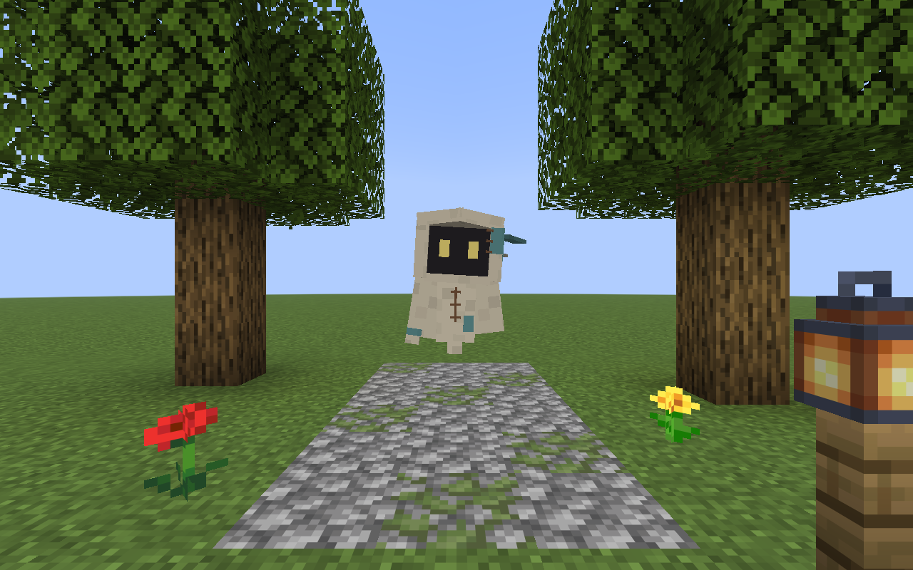

# Cloth wanderer — native development preview

The selected spirit direction, **5**, is implemented in **0.4.3-SNAPSHOT**.
The baseline is refinement **A**, the closest match to the preferred cloth
wanderer. B/C remain alternatives in the [concept archive](../../design/spirit/README.md).

This page contains **real Minecraft captures** from an isolated local test world.
They are separate from both the generated design sheets and the earlier halo-wisp
prototype. This work does not change the installed production mod or pack.

## Appearance and motion

- Warm ivory hood with an actual opening and a recessed charcoal face.
- A coarse linen material, small brown stitches and muted teal patches.
- A layered, uneven cloak hem and two independently swaying cloth streamers.
- Gentle hovering, hood inclination and centred blinking.
- Persona colours belong to the emissive eyes; the cloth keeps its own palette.
- The speech HUD portrait uses the same hood and material colours.
- The dialogue prompt describes the same hooded appearance; persona IDs and names remain stable.

The visible geometry uses small cuboids and rotated panels, with no new rendering
library or animation dependency. Native client presentation stays in the Fabric
adapter. Existing entity identity, following, ownership and saved data are unchanged.

## Native screenshots and video

| Capture | What it shows |
| --- | --- |
| [Front, daylight](images/front-day.png) | Hood opening, eyes, stitches and patches |
| [Three-quarter view](images/side-day.png) | Hood depth, layered cloak and streamers |
| [Back](images/back-day.png) | Rear construction and cloth ribbons |
| [Night](images/front-night.png) | Blue persona eyes, ordinary lantern lighting |
| [Video — MP4](video/spirit-wanderer.mp4) | 24 seconds of native animation, a full turn, night and a manual speech card |



The scene's trees, path, flowers and vanilla lantern are test props. The fixture
temporarily pins the companion near the camera and rotates it for inspection;
the video is not a claim about new AI movement or pathfinding. The final spoken
line is supplied test text through the actual speech protocol, not an LLM answer.

The MP4 contains native framebuffer samples encoded by ffmpeg as H.264, 20 fps,
1280×800, without audio. Where a capture frame is late, the preceding game frame
is repeated to keep timing; no interpolated/generated frames are added. It is not
an animation made from the concept sheets. [Capture manifest](captures.json)
records source hashes, file hashes and actual sample/output frame counts.

## Reproduce

From the mod checkout with JDK 25 and its Gradle dependencies available:

```sh
./gradlew --offline --no-daemon --no-configuration-cache runClientGameTest
```

The connected client test creates its own world, photographs the model, restores
the scene props and continues the existing UI/gameplay checks. It also reloads
resources, exercising material recreation. Output screenshots are under
`build/client-gametest/screenshots/spirit-wanderer/`.

To request a video deliberately, install `ffmpeg` on PATH and use:

```sh
./gradlew --offline --no-daemon --no-configuration-cache -PspiritVideo=true -PspiritVisualOnly=true runClientGameTest
```

The video flag adds the 24-second recording stage. `spiritVisualOnly` stops after
the isolated visual scene; omit it to continue the full connected UI/gameplay
regressions. Video and encoder diagnostics stay
under `build/client-gametest/videos/spirit-wanderer/` until deliberately copied into
this documentation. The recorder belongs to the client test source set; it is
not packaged in the player mod or executed by the normal build.
